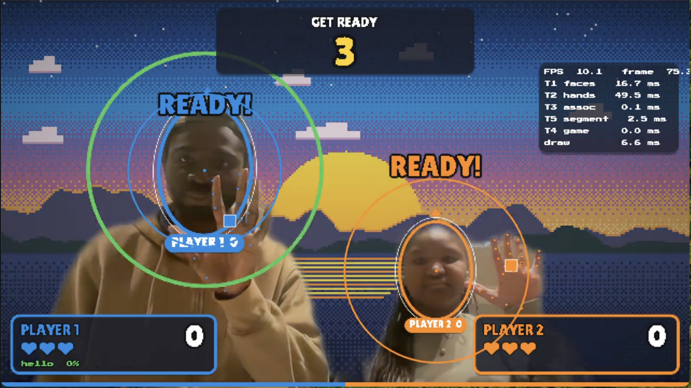

# IPCV Sign Race
A two-player webcam game. Both players stand in front of one camera. A word appears on
screen, and the first player to sign it correctly in sign language scores. Faces
identify the players, hands are tracked and their signs classified, and every hand is
assigned to the right player. The game runs in one OpenCV window, in Python.

| Task | Part | Folder |
|---|---|---|
| 1 | Face detection, recognition and tracking (YuNet + SFace) | `Task-1/` |
| 2 | Hand landmarks and dynamic sign classification (MediaPipe + scikit-learn) | `Task-2/` |
| 3 | Assigning each hand to a player (pose + geometry) | `Task-3/` |
| 4 | Game rules: rounds, scoring, hearts, levels | `Task-4/` |
| 5 | Integration: the game program, rendering, sound, arena | `Task-5/` |

## Requirements

- Python **3.12**
- A webcam
- About 500 MB free disk space for the virtual environment

**Tested setup.** These steps were tested on 2026-10-30 from a fresh clone of the
`integration` branch, on macOS 26.5 (Apple Silicon, arm64) with Python 3.12.13.
Installed versions: mediapipe 0.10.35, opencv-contrib-python 4.11.0.86, numpy 2.5.4,
scikit-learn 1.9.1, pillow 13.0.0, pygame 2.6.1. Windows and Linux have not been
tested.

## Setup

Run every command from the project root (the folder containing this README).

```bash
# 1. Create and activate a virtual environment (Python 3.12)
python3.12 -m venv .venv
source .venv/bin/activate              # Windows: .venv\Scripts\activate

# 2. Install the dependencies
pip install --upgrade pip
pip install -r requirements.txt

# 3. Download the two face models (not stored in git, about 39 MB)
mkdir -p Task-1/models
curl -L -o Task-1/models/face_detection_yunet_2023mar.onnx \
  https://github.com/opencv/opencv_zoo/raw/main/models/face_detection_yunet/face_detection_yunet_2023mar.onnx
curl -L -o Task-1/models/face_recognition_sface_2021dec.onnx \
  https://github.com/opencv/opencv_zoo/raw/main/models/face_recognition_sface/face_recognition_sface_2021dec.onnx

# 4. Check the install: should print the game's options
python Task-5/run_game.py --help
```

All other models, sounds and fonts are in the repository.

**Version notes**

- `mediapipe` stays below 1.0, because 1.0.x crashes on Apple Silicon.
- `scikit-learn` must be exactly 1.9.1, the version the sign model was saved with.

**Camera on macOS.** Allow camera access for your terminal or IDE in
System Settings → Privacy & Security → Camera.

## Run

```bash
source .venv/bin/activate
python Task-5/run_game.py --register   # first time: register both faces, then play
python Task-5/run_game.py              # later: reuse the saved faces
python Task-5/run_game.py --fake-p2    # test alone against a simulated Player 2
```

**What happens:**

1. **Title and loading screen.** The models load behind it. The first start after
   installing can take about 20 s; after that it takes 2–3 s.
2. **Registration** (only with `--register`, or when no saved faces exist). Each
   player in turn looks at the camera and presses **SPACE** to capture face samples.
   The faces are saved in `player_data/`, which stays on your computer and is not
   committed.
3. **Lobby.** Both players hold up an **open palm** to get ready. The game then
   starts after a countdown.
4. **Game.**
   - Sign the word on the card. The first correct sign scores +10.
   - A wrong sign locks that player out for 1.5 s.
   - If nobody signs the word in time, both players lose a heart (3 hearts). The word
     comes back later in the same level. So does a word both players sign at the
     same moment (a clash, no points).
   - There are 3 levels, each with its own words and less time per round. When every
     word of a level has been signed, the next level starts.
   - The game ends when every level 3 word has been signed, or when the hearts run
     out. The player with the most points wins; equal points is a draw.
5. **Game over.** The winner and match statistics are shown. Hold an open palm to play
   again.

**Options**

| Option | Effect |
|---|---|
| `--register` | Register faces again before playing |
| `--fake-p2` | Play alone; Player 2 is simulated |
| `--no-pose` | Skip the body-pose model (faster; Task 3 then uses simple circles around faces) |
| `--no-arena` | Show the plain camera image instead of the rendered pixel-art arena |
| `--mute` | No music or sound effects |
| `--log` | Write one CSV row per round to `logs/`; summarise with `python Task-5/game_log.py logs/*.csv` |
| `--camera N` | Use webcam number N (default 0) |

**Keys during the game**

| Key | Action |
|---|---|
| Q / Esc | Quit |
| D | Debug overlay: stage timings, FPS, hand ownership |
| F | Fullscreen on/off |
| R | Restart the game |
| M | Mute on/off |
| B | Arena background on/off |

**Words per level** (from `Task-4/task4_game.py`)

| Level | Words |
|---|---|
| 1 | hello, no, yes, more |
| 2 | red, apple, color, boy |
| 3 | yesterday, brown, football, water, please |

## What was tested

These were run on the fresh clone described above, without a camera:

- Install and `--help`.
- Loading all models: face, hand and sign, body pose, segmentation.
- The full perception and rendering path on synthetic frames.
- Loading every sound.
- A simulated 60-second game: start, scoring, a wrong sign, timeouts, level up,
  game over, rematch. Drawing took 4.3 ms per frame on average.

Live play with a camera was tested by the team on the development machine, not as
part of this clean-install check.

## File structure

```
IPCV-Project/
├── README.md                  this file
├── requirements.txt           one dependency list for the whole project
├── pyrightconfig.json         editor settings (import paths for the task folders)
├── player_data/               saved face registrations (created at runtime, not committed)
├── logs/                      round logs from --log (created at runtime, not committed)
│
├── Task-1/                    faces: detect, recognise, track, face effects
│   ├── README.md              Task 1 method and its own standalone demo
│   ├── config.py              all Task 1 settings (camera, thresholds, smoothing)
│   ├── registration.py        camera access, face sample capture, save/load players
│   ├── recognition.py         face detection, embeddings, one-to-one player assignment
│   ├── tracking.py            player state, smoothing, missing-frame handling
│   ├── effects.py             face ring, name tag, score panels
│   ├── evaluation.py          FPS, latency, jitter and identity-switch measurements
│   ├── main.py                Task 1 standalone demo
│   └── models/                YuNet + SFace ONNX models (downloaded, see Setup)
│
├── Task-2/                    hands and signs
│   ├── README.md              how the words were chosen, accuracy results
│   ├── START_HERE.md          short guide to the task
│   ├── src/                   hand model, features, recogniser, smoothing (used by the game)
│   ├── models/                hand_landmarker.task, sign_classifier.joblib
│   ├── scripts/               data download, feature extraction, word selection, evaluation
│   ├── notebooks/             step-by-step notebooks (setup, data, training, live demo)
│   └── data/                  recorded landmarks, word-selection results, confusion matrix
│
├── Task-3/                    which hand belongs to which player
│   ├── task3_player_association.py   pose-based hand-to-player association + debug view
│   └── models/                pose_landmarker_lite.task
│
├── Task-4/                    game rules
│   ├── task4_game.py          GameController: lobby, rounds, scoring, hearts, levels, words
│   └── task4_demo.py          Task 4 standalone demo
│
└── Task-5/                    integration: the game itself
    ├── run_game.py            START HERE: main program and main loop
    ├── bootstrap.py           makes the task folders importable, sets shared paths
    ├── pipeline.py            per-frame perception: Tasks 1-3 -> input per player
    ├── adapters.py            converts between the task modules' data formats
    ├── stabilize.py           steadier face boxes and hand owners (less jitter, fewer swaps)
    ├── segment.py             person segmentation (players vs. room)
    ├── flow.py                game flow around Task 4's rules (round timing, rematch)
    ├── feedback.py            the lines the game shows when something happens
    ├── stats.py               match statistics for the game-over screen
    ├── audio.py               music per level, sound effects, announcer voice
    ├── loading.py             title + loading screen (models load in a background thread)
    ├── measure.py             per-stage timings and FPS
    ├── game_log.py            per-round CSV for the report (--log) + summary table
    ├── theme.py               every colour, name and size used on screen
    ├── models/                selfie_segmenter_landscape.tflite
    ├── assets/
    │   ├── music/             one track per level (MP3)
    │   ├── sfx/               correct, wrong, clash, victory (WAV)
    │   ├── voice/             announcer: ready, go, level up, winner (WAV)
    │   ├── fonts/             Lilita One, Nunito, Press Start 2P (+ licences)
    │   ├── CREDITS.md         sources and licences of all assets
    │   └── SOUNDS.md          which sound plays when
    └── render/                everything drawn on screen
        ├── __init__.py        Renderer: draws one frame, in order
        ├── backdrop.py        players cut out and placed in the arena, colour grading
        ├── arena.py           pixel-art environment, one scene per level
        ├── pixel_scene.py     the pixel-art landscape (sky, sun, hills, lake)
        ├── pixelate.py        turns all overlay graphics into pixel blocks
        ├── title.py           SIGN RACE logo and loading bar
        ├── hud.py             score panels, hearts, target word card, timer
        ├── players.py         face ring and name tag that follow each player
        ├── fx.py              event animations (score, wrong, level up)
        ├── particles.py       sparks and confetti
        ├── screen_fx.py       screen flash and shake
        ├── guide.py           "how to play" panel in the lobby
        ├── winner.py          game-over screen with statistics
        ├── overlays.py        debug overlays (timings, fake Player 2)
        ├── text.py            text with real fonts (Pillow)
        ├── primitives.py      panels, bars, hearts
        └── anim.py            easing curves for animations
```

**How a frame flows through the program:**

```
camera ─► Task 1 faces ─► Task 2 hands + signs ─► Task 3 hand → player
       ─► stabilize ─► input per player ─► Task 4 rules (flow.py)
       ─► renderer (arena, players, HUD, effects) + audio ─► window
```

## Troubleshooting

| Problem | Fix |
|---|---|
| `Could not open the webcam` or a black window | Allow camera access (macOS, see Setup), or try `--camera 1` |
| Error loading `face_detection_yunet_2023mar.onnx` | Step 3 of Setup was skipped; download the face models |
| Errors when loading the sign model | Make sure `scikit-learn==1.9.1` is installed (`pip install -r requirements.txt`) |
| MediaPipe crash `Service is unavailable` | MediaPipe 1.x is installed; reinstall from `requirements.txt` (pins < 1.0) |
| No sound | Check that `pygame` is installed and that `--mute` is not set; press M to unmute |
| Low frame rate | Start with `--no-pose`, `--no-arena`, or both |
| A player is not recognised | Register again with `--register`, in good, even lighting |
